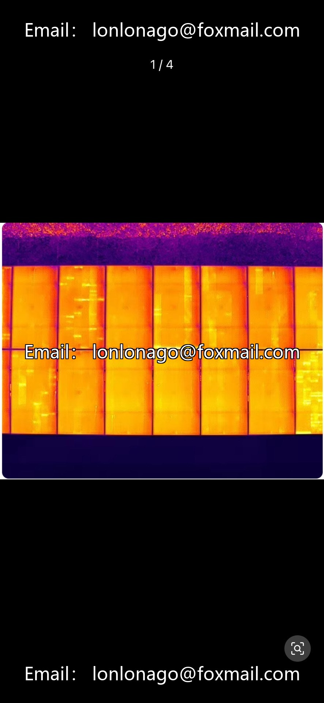
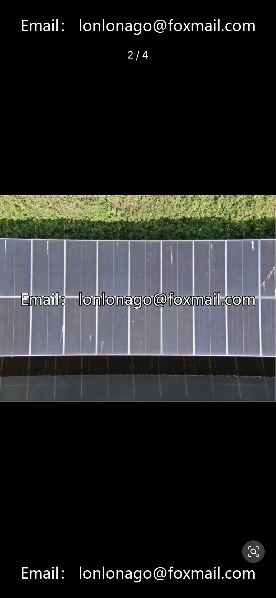
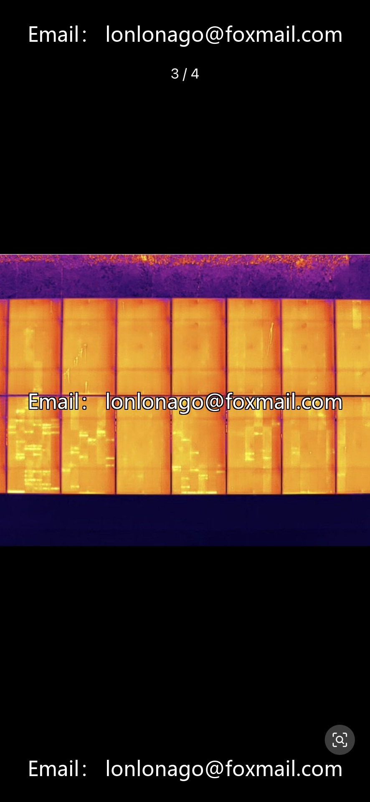
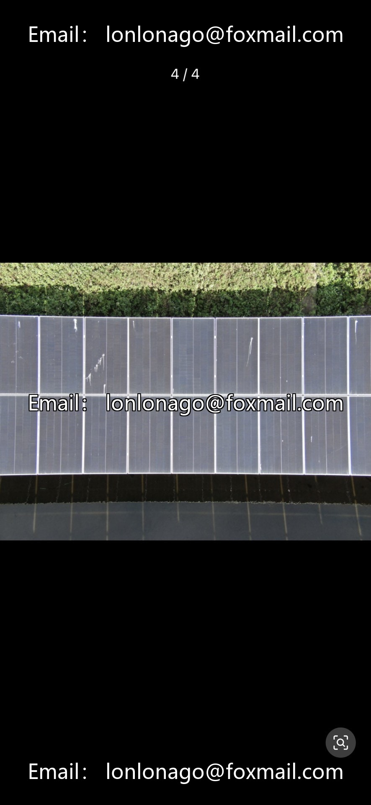

# Photovoltaic Panel Defect Detection Dataset | Infrared + Visibility Dual-Modality (YOLO format)

## Body

Photovoltaic Panel Defect Detection Dataset | Infrared + Visibility Dual-Modality (YOLO format)
650 images in infrared and visible light, 4.32GB, 10 defect labels (8 single types + 2 composite types), real power station scene, including shadow/dirt interference, small target + composite defect labeling, directly usable in YOLO format without conversion.

Suitable for drone inspection, model training, defect recognition, power station operation and maintenance, efficiency optimization.

Virtual materials, once sold, are non-refundable.
Interested friends, click "I want" to proceed.

## Images

## Payment

Here is a pay link on Stripe ( https://buy.stripe.com/3cs8yP7sY87d0vu9AB ). Please contact me lonlonago@foxmail.com after funding $89, and I will send you a complete data files , thank you!

